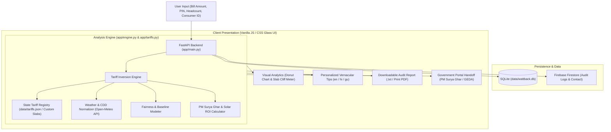

# WattBack

### Every electricity bill has a story, you just have to find a way to read it. ###
### Find out, your bill's story. ###

A bill tells you what you owe. It is much less generous with the *why*: how many units that money bought, whether a tariff slab made the last few units more expensive, or whether your home uses more electricity than you'd expect for its size.

WattBack is an experiment in turning that monthly piece of paperwork into a useful conversation. Enter a bill amount and a PIN code; get an estimate of your electricity use, a plain-language explanation, and a few ideas for what to look at next. No smart meter required. No claim that one app can fix the grid.

The ambition is practical: make energy information easier to act on, one household and one bill at a time.

---

## Problem Targeted

> **People don't know the real reasons as to why their bills are the amount they are, what causes huge jumps in them, and most importantly how they can be fixed.**

In India, electricity bills are opaque totals. Consumers pay without understanding:
1. **The Rupee-to-Unit Mystery:** How many units (kWh) their payment actually bought.
2. **The Tariff Slab Trap:** How crossing arbitrary tier thresholds (e.g., 250 units in Gujarat) triggers steep punitive slab rates and surcharges.
3. **Weather vs. Baseline Waste:** How much of the bill was driven by extreme weather (AC cooling degree-days) versus hidden standby loads.
4. **Subsidies & Action:** How to navigate rooftop solar subsidies (PM Surya Ghar) and connect with legitimate state DISCOM-empanelled installers without getting caught by third-party scams.

---

## Architecture & System Flow



### Flow Breakdown:
1. **Input & Resolution:** The client inputs a bill amount and PIN (or reverse geolocates via Nominatim).
2. **Mathematical Inversion:** `app/engine.py` numerically solves the piecewise-linear tariff function (handling telescopic slabs, fixed charges, fuel surcharges, and duties) to derive consumption in units (kWh).
3. **Weather Split:** Queries cooling degree-days (CDD above 24°C) to isolate heatwave AC impact from constant appliance baseloads.
4. **Fairness Scoring:** Compares consumption against a headcount-adjusted baseline model.
5. **Solar & Financial Models:** Sizes an optimal rooftop system, applies PM Surya Ghar central subsidies (-₹78,000), and calculates net monthly loan EMI savings.
6. **Action & Governance:** Generates downloadable text audit reports, browser-native PDF prints, and guides users directly to official government portals (`pmsuryaghar.gov.in` / `geda.gujarat.gov.in`).

---

## What you can explore

- **Bill to units:** Work backwards from a bill amount using state regulatory tariffs. Bills covering 1 or 2 months are normalized.
- **The slab trap:** Pinpoint exact units over the slab cliff and calculate the monetary penalty.
- **A little context:** Compare use against household-size baselines and cooling weather impact.
- **Rooftop solar & renters:** Explore a PM Surya Ghar solar model with EMI savings or portable renter kits.
- **Downloadable reports:** Export or print clean, formatted energy audit reports.
- **Your language, your rates:** Multi-language tips (English, Hindi, Gujarati) with support for custom printed slabs.
- **History & authentication:** Sign in via Google to track consumption history trends and compare saved checks.

---

## Setup Instructions

### Prerequisites
- Python 3.10+
- `pip` package manager
- `git`

### Step-by-Step Installation

1. **Clone the repository:**
   ```bash
   git clone https://github.com/onedhyey/WattBack.git
   cd WattBack
   ```

2. **Create and activate a virtual environment:**
   - **Linux / macOS:**
     ```bash
     python -m venv .venv
     source .venv/bin/activate
     ```
   - **Windows:**
     ```powershell
     python -m venv .venv
     .venv\Scripts\activate
     ```

3. **Install dependencies:**
   ```bash
   pip install -r requirements.txt
   ```

4. **Run the local development server:**
   ```bash
   uvicorn app.main:app --reload
   ```

5. **Open in browser:**
   Navigate to [http://127.0.0.1:8000](http://127.0.0.1:8000).

### Configuration Options
Set environment variables in your shell or configuration file:

| Variable | Purpose |
|---|---|
| `SESSION_SECRET` | Secret key for signing session cookies across restarts |
| `GOOGLE_CLIENT_ID` | OAuth Client ID for Google Sign-In |
| `FIREBASE_PROJECT_ID` | Project ID for direct Firebase logging |
| `FIREBASE_API_KEY` | Web API key for client-side Firebase Auth / Firestore |
| `FIREBASE_AUTH_DOMAIN` | Domain for Firebase Authentication redirects |
| `HTTPS_ONLY` | Set to `1` when deployed over HTTPS |
| `TARIFF_REGISTRY_URL` | Remote shared JSON URL for automated daily tariff updates |
| `ADAPTION_API_KEY` / `ADAPTION_MODEL` | Optional credentials for vernacular tip polishing |

---

## Libraries and APIs Used

### Backend & Core
- **[FastAPI](https://fastapi.tiangolo.com/)**: High-performance asynchronous API framework.
- **[Uvicorn](https://www.uvicorn.org/)**: Lightning-fast ASGI server implementation.
- **[Pydantic](https://docs.pydantic.dev/)**: Data validation, typing, and schema parsing.
- **[Starlette](https://www.starlette.io/)**: Session middleware and HTTP core primitives.
- **[SQLite3](https://docs.python.org/3/library/sqlite3.html)**: Lightweight, thread-safe embedded database for user checks and submissions.

### External APIs & Integrations
- **[Open-Meteo API](https://open-meteo.com/)**: Historical and real-time weather analytics used to calculate Cooling Degree-Days (CDD).
- **[OpenStreetMap Nominatim](https://nominatim.openstreetmap.org/)**: Reverse geocoding to resolve GPS coordinates to local PIN codes and states.
- **[Google Identity Services & Firebase Auth](https://firebase.google.com/docs/auth)**: Google OAuth sign-in and account session management.
- **[Cloud Firestore REST API](https://firebase.google.com/docs/firestore)**: Direct contact form submission and audit logging.
- **[Web Speech API](https://developer.mozilla.org/en-US/docs/Web/API/Web_Speech_API)**: Client-side text-to-speech engine for reading tips aloud in English, Hindi, and Gujarati.

---

## The honest bits

WattBack is an evidence-first prototype:
- **Tariff coverage is evolving.** It includes curated regulatory orders (starting with Gujarat DISCOMs). For unlisted states, users can type in custom rates printed on their bill.
- **Consumer ID mode is a demonstration.** Real bill retrieval uses a deterministic prototype stub pending official BBPS aggregator production access.
- **Solar and weather models provide guidance, not financial guarantees.** Final rooftop solar generation depends on shadow analysis, roof orientation, and local DISCOM net-metering approvals.

---

## Join the experiment

Try a bill with rates you can verify. Open an issue if a calculation looks off, or share an official state tariff schedule with its effective date so it can be verified and added.
